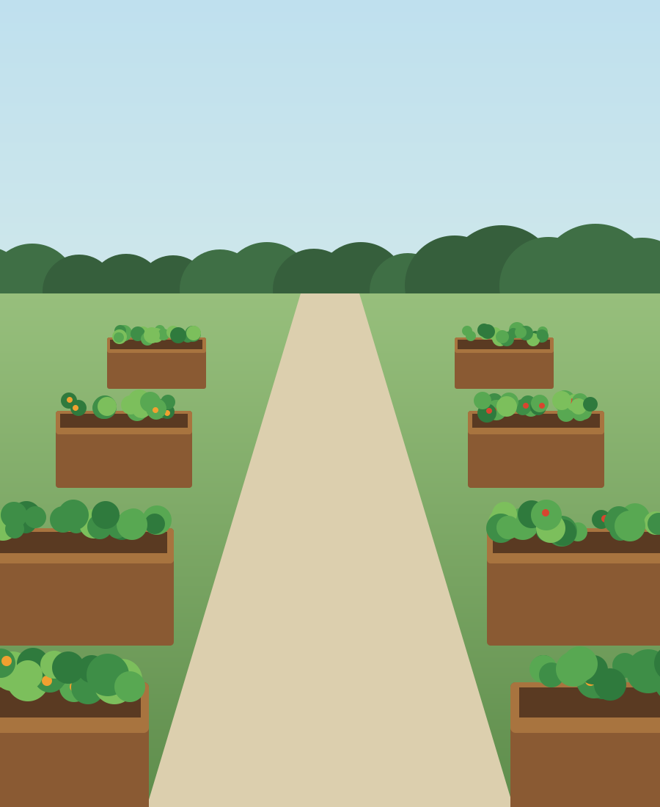

# Summary {-}

2026 was the garden's biggest season since it opened. Members logged 4.6 tonnes of produce, a quarter of it went to the food bank, and for the first time since 2019 nobody is waiting for a plot.

::: keyfigs
- **4.6 t** produce logged at the shed, up from 3.1 t in 2025
- **212** members, up from 168
- **3,140** volunteer hours on shared jobs
- **91%** of plots let: 58 of 64
:::

The four rain tanks fitted in February cut our mains water by about a third over the summer. Six raised beds by the east gate opened in May, and eleven members now garden from a seat. We spent $10,500 against a budget of $10,650.

The committee proposes a plot fee of $55 for 2027, up from $50, to pay for the composting toilet and the polytunnel. Members vote on it at the meeting (see [The 2027 fee](#fee)).

# The season in numbers

Harvest, sharing and water, from the shed log and the meter readings.

## Harvest

Members weigh what they take home at the shed scale and write it in the log[^log]. August was the peak month, as it is most years.

```chart
type: column
labels: Apr, May, Jun, Jul, Aug, Sep, Oct
values: 120, 310, 540, 820, 1140, 980, 690
suffix:  kg
highlight: Aug
caption: Produce logged at the shed by month, April to October 2026, in kilograms.
```

Tomatoes, courgettes and beans made up most of the weight, as in every year since 2021. The new beds by the east gate added 180 kg on their own, mostly salad and herbs.

## Sharing the harvest

Members gave 1.2 tonnes of fresh produce to the Northside Food Bank, about 2,400 meals^[Meals are estimated at 500 grams of produce each, the food bank's own measure.]. Volunteers made 31 Saturday drop-offs.

::: pull
A quarter of everything we grew went to the food bank.

-- Harvest log, 2026
:::

## Water

The rain tanks hold 20,000 litres in all. From June to September the garden used about a third less mains water than in 2025, and the water bill came in $300 under budget.

### How volunteers decide what to water

Twelve soil sensors report every hour. Each morning the shed screen lists the beds below 30% moisture, so volunteers water only those. The script is short:

```python
def beds_to_water(readings, dry=30):
    """Beds whose soil moisture fell below `dry` percent."""
    latest = {}
    for r in readings:                 # one reading per sensor per hour
        latest[r.bed] = r.moisture
    return sorted(b for b, m in latest.items() if m < dry)
```

# What changed on site {.opener}

Two years of building work, with one more to go.

## Works finished and planned

::: timeline
- **Nov 2025** City grant of $4,000 for water storage
- **Feb 2026** Four rain tanks fitted, 20,000 litres in all
- **May 2026** Six accessible raised beds open by the east gate
- **Oct 2026** Tool shed rebuilt with a ramp
- **Apr 2027** Composting toilet by the east gate (planned)
- **Jul 2027** Polytunnel for seedlings (planned)
:::

## Raised beds

Before May, every plot was at ground level, so members who use a wheelchair or can't kneel had nothing they could work. The six new beds stand 75 cm high on firm, wide paths, 20 metres from the car park.



> [!TIP] Booking a raised bed
> Two of the six beds are kept for new members who need them. Ask any committee member, or leave a note in the shed box.

## Before winter

Seven of the ten winter jobs are done, two are booked and one was dropped.

- [x] Water off and every pipe drained
- [x] New locks on the shed and both gates
- [ ] Tree survey of the north hedge, booked for 20 November
- [ ] Path repairs by the pond, booked for 4 December
- [-] Bonfire area: closed for good, by members' vote in June

# Where the money went

## Income

Income for the year was $11,000. Grants paid for almost half of it: the city's water storage grant and a smaller grant from the county for the raised beds.

```chart
type: donut
labels: Grants, Plot fees, Plant sale, Donations
values: 5200, 3100, 1800, 900
prefix: $
height: 56mm
caption: Income in 2026 by source, $11,000 in all.
```

## Spending

We spent $10,500, $150 under budget. The raised beds and the shed each cost $200 more than planned, and lower water bills made up the difference.

Table: Spending against budget, 2026

| Item | Budget | Spent | Left over |
|---|---:|---:|---:|
| Rain tanks and fitting | $4,000 | $3,900 | $100 |
| Raised beds | $2,400 | $2,600 | &minus;$200 |
| Tool shed and tools | $1,500 | $1,700 | &minus;$200 |
| Seeds and plants | $1,000 | $900 | $100 |
| Water bills | $900 | $600 | $300 |
| Insurance and workshops | $850 | $800 | $50 |
| **Total** | $10,650 | $10,500 | $150 |

# Membership and the 2027 fee

## How a new member gets a plot

::: steps
1. **Join the list.** Online, or at the gate on a Saturday morning.
2. **Walk the site.** A one-hour induction with a volunteer: tools, water, compost and the shared jobs.
3. **Take a plot.** Plots go in the order people joined, with two raised beds kept for members who need them.
:::

## The 2027 fee {#fee}

The committee proposes a plot fee of $55 for 2027, up from $50. At 58 plots, the extra $5 raises $290 a year, which closes the gap on the composting toilet by the end of 2027.

Proposal
: Plot fee of $55 a year from January 2027

Raised beds
: Fee stays at $30, as now

Hardship
: Members can ask the treasurer for a reduced fee, in confidence

Vote
: At the annual members' meeting, 14 November 2026

> [!NOTE] How the vote works
> Each plot holder has one vote. Members who can't come can vote by post or email to the secretary by 12 November.

# Plot records {.appendix}

Plots let at the end of each season since the garden opened.

| Season | Plots | Let | Members | Waiting list |
|---|---:|---:|---:|---:|
| 2021 | 48 | 40 | 96 | 22 |
| 2022 | 48 | 44 | 118 | 17 |
| 2023 | 56 | 49 | 131 | 12 |
| 2024 | 56 | 52 | 150 | 9 |
| 2025 | 64 | 55 | 168 | 4 |
| 2026 | 64 | 58 | 212 | 0 |

Table: Plots let and members, 2021 to 2026

[^log]: The log counts what members chose to weigh, so the true harvest is higher. About one plot in six logged nothing in June, when the scale was away for repair.
